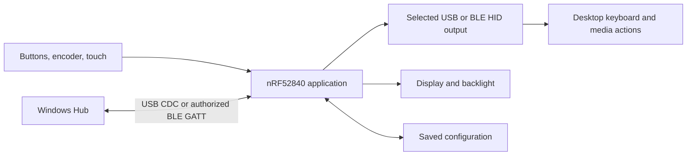

# Desk Buddy

A physical controller for everyday desktop shortcuts, with a Windows app for changing how it works.

I built Desk Buddy around six buttons, a push encoder and a touch display. It sends keyboard and media actions over USB or Bluetooth, while the Windows Hub edits its mappings, screen appearance and sleep settings. This is my independent project: I assembled the commercial modules, developed the firmware and desktop application, investigated the failures I encountered, and designed the enclosure.

The first enclosure is printed and assembled, with the lid closed and the display running. The current application baseline remains **R3H firmware and Hub 1.7.1**. Assembly exposed a mismatch between the R6 USB opening and the actual board orientation; I retained an internal USB cable and routed its free end through the battery-side opening. The [as-built record](docs/as-built.md) distinguishes this workaround from the original CAD and from the earlier internal photographs.

[Project website](https://desk-buddy-carlos-0798.brainy-bean-7549.chatgpt.site) · [Case study PDF](docs/Desk-Buddy-Case-Study.pdf) · [Engineering notes](docs/engineering-notes.md) · [Validation](docs/validation.md) · [Build](docs/build.md)

<table>
<tr>
<td width="50%"></td>
<td width="50%"></td>
</tr>
<tr><td>October 8: printed enclosure assembled and closed.</td><td>Earlier internal assembly, before the final display rotation and USB reroute.</td></tr>
</table>

## What I worked on

On the device, I brought the inputs, bilingual interface, USB/BLE output and saved settings into one application. Each of three profiles has twelve input mappings. On Windows, I built the C#/.NET WPF Hub around a separate configuration channel, with temporary previews, explicit saves and readback from the device.

The integration work reached beyond either program. I planned soldering and connector access before mounting the boards, added a dedicated backlight-control wire, and revised the enclosure around the actual leads and connectors. The first printed assembly now carries the controls on a removable lid above the battery and distribution board. The board, display, charging circuit and underlying USB/Bluetooth libraries come from existing components; my work is the application and their integration.

## How the parts connect

The Hub's settings connection has its own authorization and lifetime. It can read or edit the device without taking ownership of the selected HID route. [Architecture details](docs/architecture.md)

## Three decisions that changed the project

**Keep navigation separate from the output switch.** Opening a menu used to reset output, and physical controls depended on which page was visible. I separated the requested ON/OFF setting from the conditions that permit an action. Normal menus now preserve the setting; diagnostics can pause transmission and discard pending input. I checked the original correction across USB HID, USB-powered BLE and battery BLE on R3D8.

**Make waking a complete interaction.** Drawing a black screen left the backlight powered. I added control of the TFT's LITE pin, then treated the first input batch as a wake gesture. A release and quiet interval prevent a held touch or continuing rotation from becoming an accidental command. I observed the backlight fully off and first-touch recovery on the USB-powered R3G build. The later R3H settings and timer checks have a separate record.

**Give the disconnected Hub useful, clearly identified state.** Reopening the app showed defaults, even though reconnecting brought back the device settings. I added a last-read snapshot and an independent local draft. A new connection reads the device first; loading a draft is an explicit action. I tested restart and recovery behavior across eight isolated application processes.

[The observations and remaining questions behind these changes](docs/engineering-notes.md)

## Where it stands

The recorded R3H checks cover USB/BLE management, custom sleep settings retained through software reboot, and a 30-second idle interval while status polling continued. Hub 1.7.1 has host regression and offline UI checks; those do not substitute for exercising every feature through the real device GUI. [Revision-specific results](docs/validation.md)

The October 8 assembly establishes that the printed parts can enclose the current hardware with the documented USB workaround. The powered front photograph records the visible display state, not a new end-to-end control test. Next are closed-case control and power-transition checks, USB cable retention, and battery-powered button/encoder wake and longer-duration trials. Battery endurance has not been measured. The source also retains two unresolved observations: a temporary encoder-unavailable report and an upgrade-time language difference.

*Original R6 CAD, nominally 160 × 166 × 62.4 mm. Its USB access assumption differs from the assembled prototype; this historical image and the source meshes are unchanged. [Mechanical design](docs/mechanical-design.md) · [As-built layout and photographs](docs/as-built.md)*

## Repository

| Directory | Contents |
|---|---|
| `firmware/` | Device application and project-local DeskWire library |
| `hub/` | Windows app, shared Core and host tests |
| `cad/` | Parametric enclosure source and print geometry |
| `assets/` | Photographs, interface graphics and component artwork |
| `tests/`, `evidence/` | Scoped checks and retained validation records |

[Build instructions](docs/build.md) · [Component and asset notices](docs/THIRD_PARTY.md)

No project-wide license has been selected; the included component notices remain applicable.
