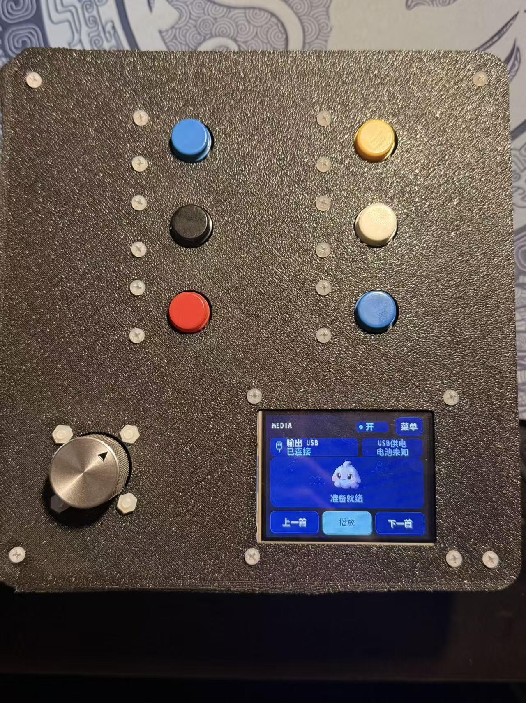
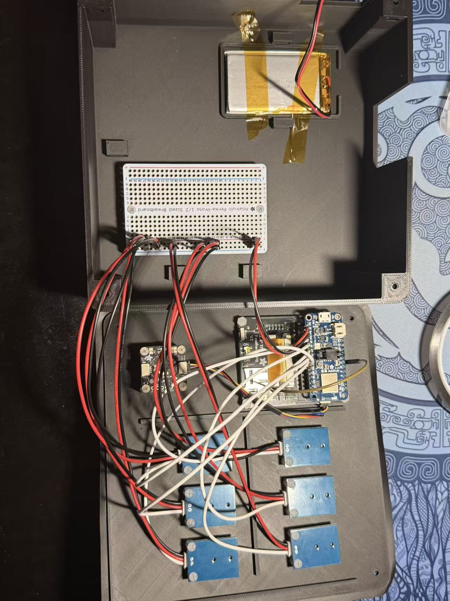

# First enclosed prototype

**Assembly recorded October 8, 2026.** I printed the R6 enclosure, mounted the controls and electronics, and closed the lid. The front photograph shows the display powered in the assembled case. Firmware remains R3H and the Windows Hub remains 1.7.1; this documentation update does not establish a new functional regression result.

*Closed assembly. The display shows USB output, USB power and a ready state. This photograph is an assembly and visible-display record, not an end-to-end HID test.*

## Installed control positions

View the front with the display text upright. The encoder is below the left column and the display is below the right column.

| Position | Left column | Color | Right column | Color |
|---|---|---|---|---|
| Top | K6 | Blue | K3 | Yellow |
| Middle | K5 | Black | K2 | White |
| Bottom | K4 | Red | K1 | Blue |

The input identities are my recorded installed order; colors are visible in the front photograph. This table changes the physical-layout record, not the firmware identities or saved action assignments. Actions remain configurable in the Hub. The two blue buttons must be distinguished by position, not color alone.

## USB access change

The actual nRF52840 board sits on the right side of the TFT arrangement, contrary to the left-side assumption used for the original access opening. The printed opening did not expose the USB connector.

I rotated the display assembly 180 degrees and connected the USB cable inside the enclosure. The cable exits through the opening near the battery and remains part of this prototype; normal plugging and unplugging now happens at the computer end. The original R6 CAD and meshes have not been revised to represent this arrangement.

The workaround allowed assembly to proceed, but I have not established strain relief, pull resistance or a full mechanical clearance result. A future revision should position the opening from the actual mated display/Feather stack and include the USB plug housing, bend path and retention feature.

## Internal construction record

**All four internal photographs below show the earlier assembly, before the final display rotation and USB reroute.** They are useful records of the upper controls, lower battery/distribution board and interconnecting harness. They do not show the final internal USB cable path.

| Photograph | What it records |
|---|---|
| [Upper assembly](../assets/assembly-2026-10-08/02-upper-internals-before-usb-reroute.jpg) | Six button boards, encoder and Feather/TFT stack mounted behind the lid; earlier orientation |
| [Lower battery and Perma-Proto](../assets/assembly-2026-10-08/03-lower-battery-perma.jpg) | Battery tray and distribution-board mounting during the earlier assembly |
| [Upper detail](../assets/assembly-2026-10-08/04-upper-internals-detail-before-usb-reroute.jpg) | Earlier display/Feather orientation and signal/power harness |
| [Open enclosure overview](../assets/assembly-2026-10-08/05-open-enclosure-before-usb-reroute.jpg) | Controls on the lid, battery and distribution board in the base, and leads between the two |

*Earlier internal configuration. The two-level layout has no complete intermediate divider; the harness connects the lid assembly to the base.*

## What this milestone establishes

The print and assembly are complete, and the front display is visibly powered with the case closed. The USB-opening mismatch and installed button order are now part of the engineering record. The nominal case dimensions remain 160 × 166 × 62.4 mm from CAD; no new physical dimensional measurement is claimed.

Closed-case button/encoder/touch behavior, USB/BLE operation, power transitions, cable retention, charging behavior and endurance need their own recorded checks. The earlier software and device results retain their dates and revision scope in the [validation record](validation.md).

[Mechanical design](mechanical-design.md) · [Engineering notes](engineering-notes.md) · [Original R6 CAD](../cad/README.md)
