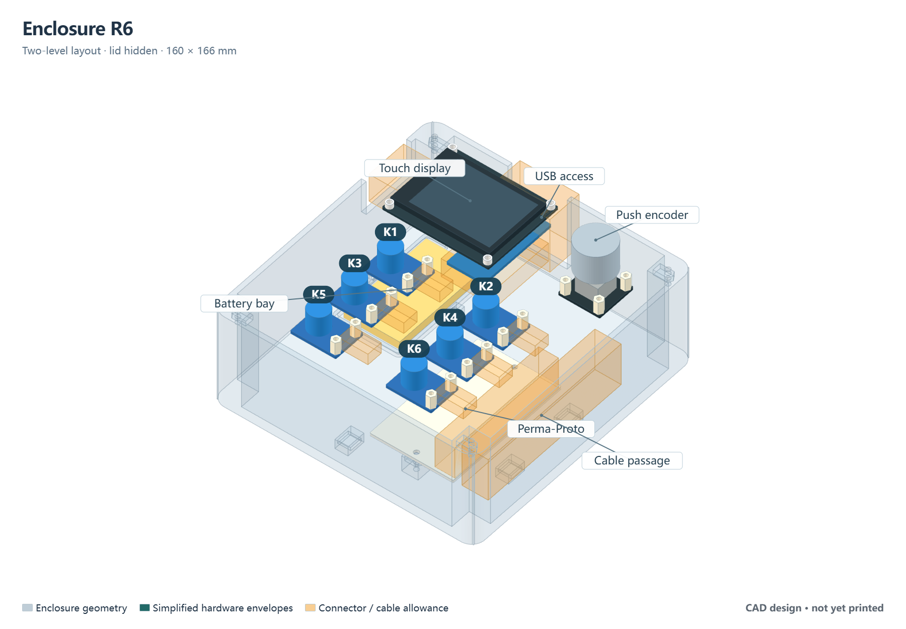

# Enclosure design

I designed the enclosure after working with the connected boards and leads on the bench. By October 8, 2026, I had printed the R6 parts, mounted the hardware and closed the enclosure. A powered front photograph records that assembly milestone. The first fit also exposed a USB-access error, so the assembled prototype differs from the original CAD as described below.

*Original R6 nominal envelopes and reserved space. Orange regions indicate allowances rather than printed parts. This historical CAD image does not show the final display rotation or retained USB cable.*

## Keeping the assembly accessible

Before soldering, I considered placing the Perma-Proto board within the Feather/TFT stack. That arrangement left unresolved questions about insertion depth, clearance and access to later joints. I kept the native Feather-to-TFT connection and moved the full 81.28 × 50.8 mm distribution board to its own lower mount.

The resulting enclosure has two levels. The removable lid carries the display, encoder and buttons; the base holds the battery and distribution board. An open side passage leaves room for the harness and for lifting the lid onto a support. There is no full intermediate divider.

The first assembly plan accounted for 28 Feather header joints and 14 power-distribution joints. I kept soldering and inspection ahead of enclosure mounting so those connections would remain accessible. The later backlight-control wire is additional to that original 42-joint plan. The [hole and net record](../cad/reference-r4/solder-42-points.csv) retains the earlier layout coordinates.

## Why the case became larger

An earlier candidate was 118 × 138 × 48 mm. R6 is **160 × 166 × 62.4 mm**, excluding the knob and screw heads. I expanded it to include retained connector housings, long pin tails, cable bends and removal paths. Those constraints became clearer from the actual assembly than from the initial outline.

The base is 60 mm high, with a 2.8 mm floor and 3 mm walls; the lid skin adds 2.4 mm. A roughly 16 mm side passage carries wiring between levels. The Perma supports are 10 mm high, allowing more underside space than the early layout after photographs showed substantial lead-tail projection.

| Feature | Current design |
|---|---|
| Board attachment | 22 points: TFT 4, encoder 4, buttons 12, Perma 2 |
| Lid attachment | Four corner fasteners |
| TFT | Four 3 mm printed spacers at the front and FF6 posts at the rear |
| Buttons and encoder | Sixteen FF8 posts; nominal Ø14 mm button and Ø22 mm encoder openings |
| Battery space | 38 × 68 mm tray based on a nominal 34 × 62 × 5 mm battery |
| Modeled external access | 36 mm rear USB opening and a 34 × 22 mm switch-access notch; the USB opening proved misaligned at assembly |

The [parameter file](../cad/source/parameters.json) holds the original design dimensions. R6 uses X right, Y toward the modeled rear USB opening and Z up. These coordinates are not a description of the final cable exit.

## What the first assembly changed

The actual nRF52840 board sits on the right side of the TFT arrangement, rather than the left-side assumption I used for access planning. The printed opening therefore did not expose the USB connector. I rotated the display assembly 180 degrees, connected the USB cable inside the case and led it out through the opening near the battery. The cable remains with the prototype; routine connection and disconnection happen at the computer end.

That change let me close the current enclosure without reprinting it. It does not establish cable strain relief or make the original connector-access geometry correct. The next mechanical revision needs to locate the opening from the fully mated assembly and include the plug housing, cable bend and retention feature in the fit check.

The button positions also differ from the intended assembly order. Viewed from the front with the display upright, the left column is K6, K5, K4 from top to bottom and the right column is K3, K2, K1. I recorded the installed identities rather than assuming that panel position changed the firmware mapping. The [as-built table](as-built.md) includes button colors and the photo record.

The internal photographs were taken **before** the final display rotation and USB routing. They document the two-level construction and wiring, but are not photographs of the final cable path.

## Original print geometry and remaining checks

The selected set contains one [base](../cad/stl/10_base.stl), one [lid](../cad/stl/11_lid.stl) and four [TFT spacers](../cad/stl/12_tft_spacer_3mm.stl). The portable generator reproduced the seven archived mesh types byte-for-byte in the recorded [rebuild check](../cad/qa/rebuild-check.json). That is a reproducibility result for the digital geometry.

Physical assembly is complete, but the photographs do not measure connector withdrawal, screwdriver access, glass clearance, thread engagement, input travel or battery-support loads. A conservative PH3 plug envelope in the original model overlaps an adjacent hex-post envelope by about 0.877 mm³ per pair; that digital concern has not received a separate measured clearance result. Harness movement, solder-tail clearance, cable retention and closed-case functional operation still need focused checks.

The next useful result is a recorded closed-case control and power-transition check, followed by a revised USB opening and retention design for a future print. The original source and STL files are retained so the first print remains reproducible.

[CAD source and print files](../cad/README.md) · [Project status](validation.md)
